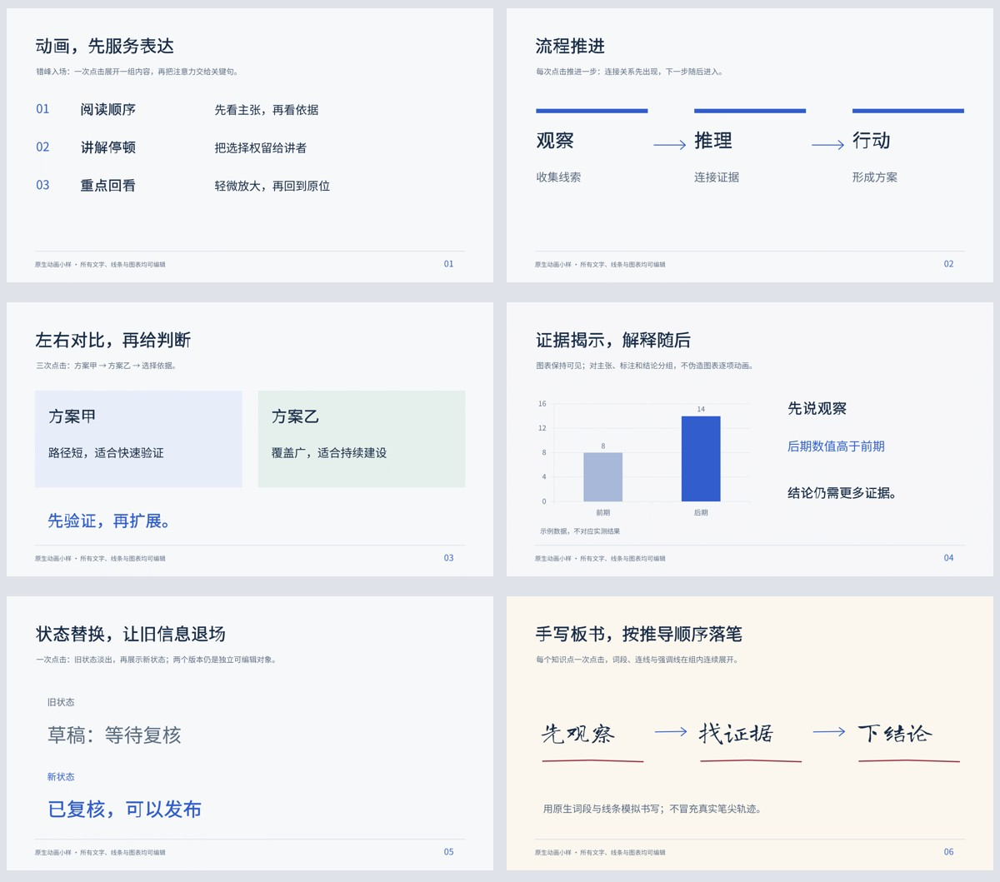

# 六种原生动画编排小样

这是动画编译器的原创验证样本，展示从开源研究中吸收的编排方法。它由代码直接构建，没有调用imagegen，不作为“主题→imagegen→重建”的自动创作案例；完整创作试跑见[修补日](../auto-workshop/README.md)。

[下载PPTX](motion-lab.pptx) · [下载完整PPTD与场景工程](motion-lab-project.zip) · [查看实际播放GIF](playback.gif) · [验收记录](validation.json)



| 页码 | 编排 | 实际行为 | 点击组 |
|---|---|---|---|
| 1 | 错峰入场与重点回看 | 按阅读顺序淡入；已有关键词轻微放大后复位 | 2 |
| 2 | 流程推进 | 每步一次点击，先擦入连接箭头，再淡入下一节点 | 3 |
| 3 | 左右比较 | 两侧从外边缘进入，最后缩放显示判断 | 3 |
| 4 | 证据揭示 | 图表保持静态；主张、数据解释与结论分组显示 | 3 |
| 5 | 状态替换 | 旧状态先淡出并隐藏，再出现新状态 | 1 |
| 6 | 手写推导 | 原生词段、连接线、箭头尖与强调线按顺序擦入 | 3 |

全部77个画面对象为原生对象，包括56个文本框与1个图表，没有整页截图或词图。图表数值明确标为示例。六页共41个元素动画、15个点击组；点击组数量由导出及PowerPoint另存文件读取确认，自动视频不等于人工核对了现场点击停顿。

## 重新生成

安装仓库`requirements.txt`，在仓库根目录使用依赖完整的Python 3.10+，输出目录须为新目录：

```powershell
python examples/motion-lab/build.py --output-dir output/my-motion-lab
```

构建器写`source/scene.json`与模板，再通过仓库原生后端生成`project/deck.pptx`、`deck.pptd`、pages、字体及许可文件；无需额外WASM导出器。`source/template/layout.svg`是明确标记的技术版式夹具，不是imagegen参考稿。

需要自动播放编排时追加`--autoplay`，避免把演讲者点击停顿直接当作录播时间。源PPTD携带全部元素、动画参数与字体，但本例未验证其他PPTD编辑器能预览所有新增效果；准确复现以`scene.json`及本仓库编译器为准。

Windows安装PowerPoint时可按顺序验证：

```powershell
./scripts/embed_fonts_windows.ps1 -InputPptx output/my-motion-lab/project/deck.pptx -OutputPptx output/my-motion-lab/project/motion-lab.pptx -FontMap output/my-motion-lab/project/font-map.json
python scripts/check_motion.py output/my-motion-lab/project/deck.pptx output/my-motion-lab/project/motion-lab.pptx --output output/my-motion-lab/motion-preservation.json
./scripts/render_pptx_windows.ps1 -InputPptx output/my-motion-lab/project/motion-lab.pptx -OutputDir output/my-motion-lab/rendered -FontMap output/my-motion-lab/project/font-map.json
./scripts/render_animation_windows.ps1 -InputPptx output/my-motion-lab/project/motion-lab.pptx -OutputVideo output/my-motion-lab/playback.mp4 -FrameRate 30 -SecondsPerSlide 2 -FontMap output/my-motion-lab/project/font-map.json
```

## 实测与修复

- PowerPoint 16.0实际打开、嵌字、另存、逐页导图并生成视频；逐页文字越框候选为0。字体通过会话临时加载，结束后撤销。
- 最初同一对象的入场与强调复用了构建组标识，另存后强调被丢弃。修正为每次动画独立标识后，41个动画均完整保留，点击组与毫秒时序也一致，见[另存比对](motion-preservation.json)。
- 视频中确认了飞入、缩放、强调后复位、淡出隐藏和手写顺序。流程节点从横向飞入改为淡入，避免横穿已有节点；方向关系继续由连接箭头表达。
- 另有内部单页探针验证四向飞入及同一对象“入场→强调→退出→再入场”，覆盖8种原生效果；12个动画在另存后均保留，实际视频检查了各阶段。

嵌入的两份字体由PowerPoint写为压缩EOT，结构工具无法严格解压验证其有效载荷；实际字形通过供给字体的导图和视频核对。WPS、Keynote、LibreOffice及其他PPTD编辑器未测试，不推断兼容结果。静态导图包含编辑状态下的对象，不能代替含退场动画的播放画面。

动画选型与开源来源见[动画设计参考](../../references/motion-design.md)。
